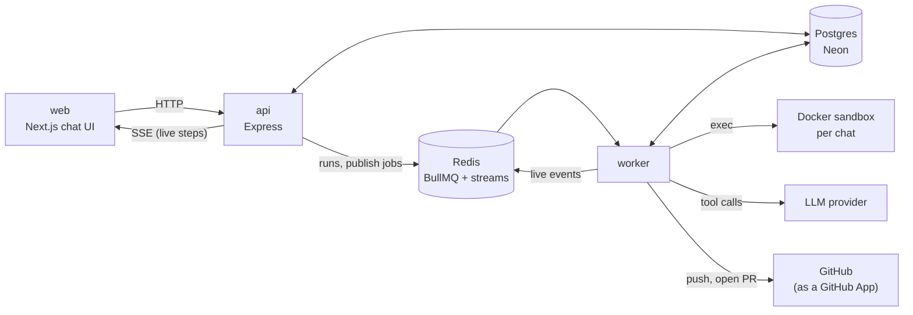

# Architecture

weft runs a coding agent against a GitHub repository in a locked-down sandbox. A chat is a
sequence of turns; each turn is a job that a worker picks up, runs to completion and records.
This page is the map; the package READMEs have the detail, and
[`decisions/`](decisions) records why each piece works the way it does.

## Components

| Part               | Responsibility                                                                              |
| ------------------ | ------------------------------------------------------------------------------------------- |
| `apps/web`         | Chat UI: conversations, the live work log, the changes panel, commit and Create PR dialogs. |
| `apps/api`         | Sessions, messages, commits, cancel, publish requests; relays a run's live stream as SSE.   |
| `apps/worker`      | Executes turns and publish jobs. Stateless apart from a small pool of kept sandboxes.       |
| `packages/agent`   | The agent: tools and loop, independent of where it runs. Also the eval suite.               |
| `packages/sandbox` | Docker containers with no network, no capabilities, uid 1000 and resource limits.           |
| `packages/llm`     | One interface over Anthropic, OpenAI-compatible APIs (OpenAI, Gemini, OpenRouter), a mock.  |
| `packages/db`      | Schema and queries (Drizzle). Postgres is the source of truth.                              |
| `packages/queue`   | The `runs` and `publish` queues and the per-run Redis live stream.                          |
| `packages/github`  | GitHub App auth: app JWT, repo-scoped installation tokens, pull request calls.              |

## A turn, end to end

1. **Message.** The API stores the message as the session's next run (`turn` = 1, 2, …) and
   queues its id. A unique index allows one active turn per session.
2. **Claim.** A worker claims the run and gets an `attempt` number, a fencing token: every later
   write is conditional on it, so a cancelled or taken-over run can't overwrite a newer result.
3. **Sandbox.** A follow-up reuses the sandbox its chat kept from the previous turn, after
   checking it still matches. Otherwise the worker clones on the host and starts a sandbox from
   the repo's dependency image (dependencies as copy-on-write layers), or installs dependencies
   with network, then cuts the network. Earlier turns' work is restored by applying the latest
   cumulative diff.
4. **Agent.** The loop sends the conversation and a short repository overview to the model and
   runs its tool calls in the sandbox (`grep`, `glob`, `view_file`, exact-string edits,
   commands, tests) until it calls `finish`. It searches the code itself; there is no embedding
   index. Every step is saved as a trace and streamed live.
5. **Diff and verify.** The worker collects the change as a binary-safe git diff against the
   base branch, then reruns the test command itself in a fresh sandbox with only that diff
   applied, so nothing the agent left outside the diff affects the verdict.
6. **Record.** Status, diff, tokens, timings and failure detail are written (fenced); the
   sandbox is kept for the next turn or destroyed.

## Publishing

The user commits when work is ready, with a message drafted by the model and edited in a
dialog. Create PR queues a publish job: the worker pushes one git commit per saved commit to a
`weft/<title>-<id>` branch, as the app's bot, and opens the pull request with a generated title
and description. Pushes only move the branch forward. The installation token is scoped to one
repository, lives about an hour, reaches git only as an environment-provided header, and never
enters a sandbox.

## Design principles

- **Postgres is the truth; Redis is transport.** Queue jobs carry only ids; live streams expire.
  A lost stream or job never loses a result.
- **Untrusted code only runs in the sandbox.** Install scripts and tests included; the host only
  clones, copies and pushes.
- **Verify, don't trust.** Tests are rerun outside the agent's sandbox, and nothing is committed
  or published while they fail.
- **Provider-agnostic agent.** The loop never knows which model it talks to, and each chat picks
  its own.
- **Measured changes.** Phase timings on every run, and an eval suite
  ([ADR 0007](decisions/0007-agent-evals.md)) for agent changes.

## Known limits

One worker's sandbox pool is in memory, so a follow-up on another worker starts cold. Incremental
installs are npm only. Only public repositories with the app installed can be published. The
sandbox is Docker with no network, not a VM or gVisor.
